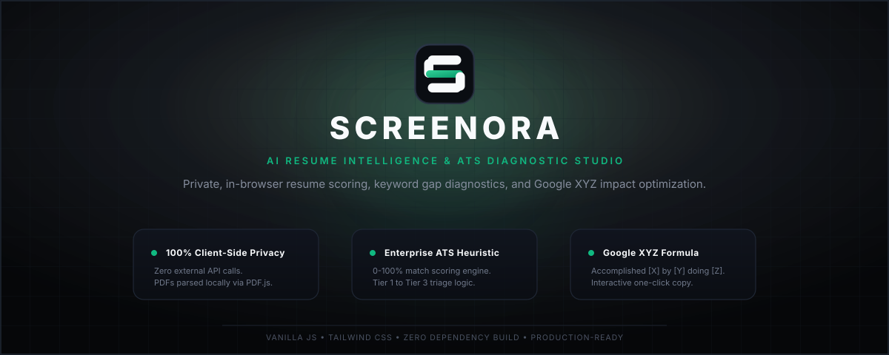

# Screenora



Screenora is an independent, client-side resume intelligence and Applicant Tracking System (ATS) diagnostic engine. Built with industrial psychology insights and corporate recruiter screening benchmarks, Screenora parses, analyzes, and scores candidate CVs in real time directly within the browser—without transmitting personal career data to third-party cloud servers.

---

## The Problem Screenora Solves

Modern corporate recruiting relies heavily on automated ATS filters that silently reject up to 75% of qualified applicants before a human recruiter ever reviews the resume. The primary root causes for premature rejection include:

1. **Passive Task-Based Descriptions:** Listing duties ("Responsible for managing...") rather than measurable business impact.
2. **Missing Hard Competency Keywords:** Lack of specific tools, domain terminology, and framework designations required by job specifications.
3. **Absence of the Google XYZ Formula:** Failure to structure achievements as *Accomplished [X], measured by [Y], by doing [Z]*.
4. **Data Privacy Concerns:** Job seekers hesitating to upload sensitive personal documents, contact details, and career histories to opaque external AI servers.

Screenora resolves these challenges through a deterministic, client-side heuristic engine that delivers immediate, actionable feedback in under 3 seconds.

---

## Key Capabilities

### 1. 100% Client-Side Privacy (Zero-Data Retention)
Document parsing is executed entirely inside the browser environment utilizing `PDF.js` for digital PDF streams and native `FileReader` APIs for plain text and document fallbacks. No resume content, contact information, or metadata is ever transmitted, logged, or stored on external infrastructure.

### 2. Heuristic ATS Scoring & Decision Tiers
The diagnostic engine evaluates candidate text across four weighted competency dimensions:
- **Keyword Density & Domain Alignment (45%):** Match ratio against curated industry competency dictionaries.
- **Quantifiable Metrics & Impact Density (25%):** Detection of numerical outputs, percentages, currency, and measurable indicators.
- **Active Action Verb Ratio (15%):** Verification of outcome-driven verbs over passive administrative phrases.
- **Section Completeness & Structural Parsability (15%):** System readiness across Experience, Education, Skills, and Certification blocks.

Candidates receive an overall Match Score (0–100%) mapped directly to three corporate triage tiers:
- **Tier 1 (Score ≥ 80%):** Shortlist Candidate (High Fit) — Green indicator.
- **Tier 2 (Score 65% – 79%):** Potential Backup Candidate (Moderate Fit) — Amber indicator.
- **Tier 3 (Score < 65%):** High Rejection Risk (Significant Gaps) — Red indicator.

### 3. Competency Gaps & Actionable Insights
Screenora outputs a structured bento grid detailing:
- **Verified Competency Strengths:** Highlighting matched core terms to emphasize during interviews.
- **Critical Qualification Gaps:** Flagging missing software keywords and unquantified bullets that trigger ATS filters.

### 4. Google Formula XYZ Sentence Optimization
The platform provides a side-by-side comparative overhaul of weak or passive sentences detected in the CV, transforming them into executive-level, impact-driven statements following Google's proven hiring formula:
```
Accomplished [X], measured by [Y], by doing [Z]
```
Includes an instant one-click copy function for direct insertion into resume documents.

### 5. STAR Behavioral Interview Probing
For identified qualification gaps, Screenora automatically generates tailored behavioral interview questions using the **STAR** (Situation, Task, Action, Result) methodology, allowing applicants to prepare structured answers for difficult recruiter probing questions.

### 6. Dual-Theme & Bilingual Localization
- **Design System:** High-contrast Obsidian Dark (`#0A0B0E`) and Gallery White (`#F8F9FB`) with emerald accents, built on Swiss editorial typography principles.
- **Language Support:** Instant runtime switching between Indonesian (ID) and English (EN) with complete state persistence via `localStorage`.

### 7. Focused Checkout & Mentorship Modals
Dedicated, independent modal windows for service access:
- **Full ATS Diagnostic Report (Rp 10.000):** Comprehensive 10-page analysis with instant national QRIS simulation.
- **1-on-1 Consultation (Starting at Rp 25.000):** Private 45-minute live review and STAR interview rehearsal via WhatsApp integration.

---

## Architecture & Technology Stack

Screenora is deliberately architected as a lightweight, zero-dependency standalone application optimized for performance and resource efficiency:

- **Core Engine:** Vanilla JavaScript (ES6+ modular closures, zero external runtime framework overhead).
- **Styling:** Tailwind CSS (via CDN) paired with bespoke CSS overrides for custom micro-animations and scrollbar hygiene.
- **Document Extraction:** `PDF.js` v3.11 (client-side web worker for fast binary stream parsing).
- **Typography:** Plus Jakarta Sans & Inter (Google Fonts).
- **Execution Model:** Zero build step required. Operates directly via the file protocol or static web hosting.

---

## Project Structure

```
Screenora/
├── index.html        # Semantic HTML5 application shell & view templates
├── style.css         # Custom layout overrides, themes, and micro-interactions
├── app.js            # Client-side extraction, scoring heuristic, and state machine
├── banner.svg        # High-resolution vector banner for repository documentation
└── README.md         # Technical architecture documentation
```

---

## Quick Start

### Running Locally

Screenora requires no Node.js installation, no compilation, and no package manager.

1. Clone or download this repository:
   ```bash
   git clone https://github.com/faarimuhammad2502/Screenora.git
   ```
2. Navigate into the project directory:
   ```bash
   cd Screenora
   ```
3. Open `index.html` directly in any modern web browser (Chrome, Edge, Firefox, Safari, or Zen Browser):
   - **Windows:** Double-click `index.html` or run `start index.html` in PowerShell.
   - **macOS / Linux:** Run `open index.html` or `xdg-open index.html`.

---

## Target Roles Supported

Out of the box, Screenora features tailored competency matrices for:
1. **HR Generalist & Talent Acquisition:** Psychology fundamentals, STAR interviewing, HRIS, sourcing, and people analytics.
2. **Business Analyst:** Data analysis, KPI dashboards, SQL/BI modeling, and requirements engineering.
3. **Shadow Teacher & Special Needs Educator:** Behavior modification, IEP design, ADHD/ASD support, and inclusive pedagogy.
4. **Frontend & Web Developer:** Modern DOM, JavaScript/React, Tailwind CSS, performance budgets, and responsive architectures.
5. **Custom Roles:** Dynamic heuristic keyword parsing for any entered job title.

---

## Security & Data Privacy Guarantee

- **No Remote Telemetry:** The application does not collect analytics or track user sessions.
- **Zero Third-Party Model Storage:** No resume text is indexed or used to train public machine learning models.
- **Sandbox Security:** Text processing resides strictly within the user's browser memory heap and is flushed upon session refresh.

---

## Disclaimer

Screenora is an independent career diagnostic simulation tool based on heuristic algorithms and industry best practices. It is not affiliated with, endorsed by, or guaranteeing employment offers at any specific enterprise, institution, or state-owned corporation.

---

## License

This project is open-source software provided under the [MIT License](LICENSE).
